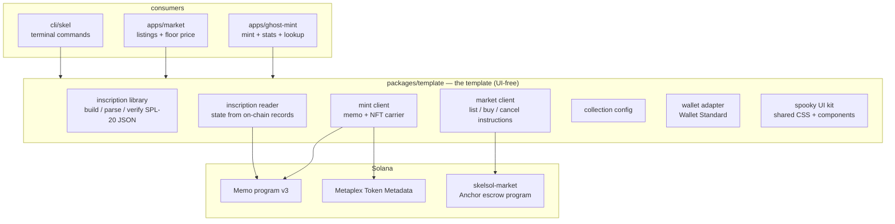

# Skelsol

A lean template (skeleton) for minting SPL-20-style inscriptions on Solana,
shown through two web applications and one CLI. Built for
[Kiroween 2026](https://kiroween.devpost.com) (submission period
30 October – 4 December 2026), category **Skeleton Crew**.

One mint writes an inscription — a JSON record in the SPL-20 shape — into
the memo of a Solana transaction, and mints a Metaplex NFT as the
inscription's carrier. One mint, one inscription, one carrier NFT.

```json
{"p":"spl-20","op":"mint","tick":"GHOST","amt":"1","mint":"<carrier NFT mint>"}
```

The demo collection is **GHOST** ("Spooky Ghosts"): supply 4,444,
4 inscriptions per wallet, free mint (you pay only the rent deposits).
Both demo apps and the CLI default to **devnet**, so anyone can try the
whole flow for free. A network switch moves each app to mainnet.

| | |
|---|---|
| Ghost Mint (demo) | https://skelsol-ghost-mint.vercel.app |
| Inscription Market (demo) | https://skelsol-market.vercel.app |
| Demo video (1:53) | https://youtu.be/HBE63hOJhyI |
| Devpost submission | https://devpost.com/software/skelsol |

> **Status, stated plainly (19 November 2026):**
>
> - **Minting works on devnet today.** It needs no custom program — it
>   uses the Memo program and Metaplex Token Metadata — and it has been
>   verified live on devnet via `skel status`.
> - **The market program is deployed on devnet** (19 Nov 2026).
>   The escrow program (`skelsol-market`) is live at program ID
>   `3XMFqwbEND9gYWoTahNQPhVoNspHet1PfdizsRymqwNo` (see
>   [Deploy](#deploy-status) and `docs/DEPLOY.md`). Listing, buying,
>   and cancelling work on devnet in both apps and in the CLI.
> - **The wallet handshake and live mint in a real browser have not been
>   tested here** (no browser extension exists in this environment). A
>   real-browser check with Phantom/Solflare is still needed before
>   demo day.

## The three consumers

One template package, three consumers. No consumer duplicates template
logic: a bug fixed in the template is fixed everywhere.

| Consumer | What it is | Where |
|---|---|---|
| **Ghost Mint** | Web app 1: mint ghost inscriptions, live stats, wallet lookup, minter leaderboard, live activity | `apps/ghost-mint/` |
| **Inscription Market** | Web app 2: list, buy, and cancel inscription sales at fixed prices, with on-chain escrow | `apps/market/` |
| **skel** | CLI for AI agents: `status`, `mint`, `list`, `buy`, `cancel`, `lookup`, with `--json` output and a local keypair wallet | `cli/`, manual in `agent.md` |

Two web apps satisfy the Skeleton Crew requirement of two distinct
applications; the CLI is a third consumer that strengthens the template
story. See `docs/adr/0001-skeleton-crew-three-consumers.md`.

## Architecture



There is no server, no database, no API route. All state is on-chain;
every read goes straight from the consumer to a public Solana RPC.

### The mint flow

1. The user (or agent) asks to mint from a collection.
2. The mint client checks the reader: is supply left, is the wallet
   under its per-wallet limit? If not, it refuses with a reason.
3. One transaction is built: a Memo instruction carrying the
   inscription JSON, plus the Metaplex `createNft` instructions that
   mint the carrier NFT. The transaction is serialized first and
   refused if it exceeds the 1,232-byte packet cap.
4. The wallet signs; the client returns the transaction signature and
   an explorer link.

### The market flow

The escrow program (`programs/skelsol-market/`, Anchor) holds a listed
carrier NFT in a PDA-owned vault until it is bought or cancelled:

- **List:** the NFT moves into escrow; a `Listing` account stores the
  seller, the mint, the price, and the bump.
- **Buy:** one atomic transaction pays 99% of the price to the seller,
  1% to the treasury, and releases the NFT to the buyer.
- **Cancel:** only the seller can cancel; the NFT returns to the
  seller and the listing closes.

`buy` takes no price argument: the program always charges the price
stored in the listing, never client input. The fee recipient is a fixed
`TREASURY` constant in the program, never a client-supplied account.
The TypeScript market client builds these instructions by hand with
`@solana/web3.js` from the committed IDL — there is no Anchor 1.x
TypeScript client on npm (see ADR 0010).

### Repo layout

```
packages/template/        the template library + spooky UI kit
apps/ghost-mint/          web app 1 (static site: tsc + build.mjs)
apps/market/              web app 2 (static site: tsc + build.mjs)
cli/                      skel CLI (TypeScript, Node.js)
programs/skelsol-market/  Anchor escrow program (list / buy / cancel)
docs/                     spec, research, ADRs, deploy + submission docs
.kiro/specs/skelsol/      Kiro spec: requirements, design, tasks
agent.md                  AI-agent manual for skel
GLOSSARY.md               shared vocabulary (start here)
```

## Quickstart

Prerequisites: Node.js 18+ and npm. (The Anchor program needs the Rust /
Solana toolchain; see `docs/DEPLOY.md`.)

```sh
npm install          # install workspace dependencies
npm test             # full unit suite (vitest, offline)
npm run typecheck    # tsc --build across the workspace
npm run build        # typecheck + build the CLI binary
```

### Run the apps

Each app builds to a static site in its own `dist/` directory — no
server needed. Serve it with any static host, or locally:

```sh
cd apps/ghost-mint && npm run build
npx serve dist            # or: python3 -m http.server -d dist
```

```sh
cd apps/market && npm run build
npx serve dist
```

Both apps default to devnet. Connect Phantom or Solflare from the
in-app wallet button. The network switch in the top bar moves the app
to mainnet (real SOL — see the warning in the apps).

### Run the CLI

```sh
cd cli && npm run build
node dist/cli.js --help
# or: npm link, then `skel --help`
```

Read `agent.md` before running any write command. The short version:

```sh
skel status                                   # collection state (read-only)
skel lookup <wallet>                          # one wallet's inscriptions
skel mint --keypair ./agent-keypair.json      # mint one GHOST inscription
skel list <mint> <price-lamports> --keypair ./agent-keypair.json
skel buy <seller> <mint> --keypair ./agent-keypair.json
skel cancel <mint> --keypair ./agent-keypair.json
```

Every write shows a transaction preview first and sends only after you
type `yes` for that exact action. There is no `--yes` flag. `--json`
prints machine-readable output on stdout (previews stay on stderr).
Market commands (`list`, `buy`, `cancel`) work on devnet and refuse
with a clear message on mainnet, where the escrow program is not
deployed — see the status note at the top.

Make an agent wallet with the Solana CLI and fund it free from the web
faucet (https://faucet.solana.com). Never commit a keypair file; never
use a keypair holding large funds.

## The judge path

Everything below is free on devnet. You need a Solana wallet
(Phantom or Solflare) in a real browser.

1. **Get devnet SOL.** Open https://faucet.solana.com, paste your
   wallet address, request up to 5 SOL (max 2 requests per 8 hours).
   The CLI airdrop against the public RPC is closed, so use the web
   faucet.
2. **Mint.** Open [Ghost Mint](https://skelsol-ghost-mint.vercel.app), connect your wallet, mint one GHOST
   inscription. The app shows the exact cost before you confirm, then
   gives you an explorer link to the transaction — open it and find
   the inscription JSON in the transaction logs. Priced collections
   actually collect the mint price: the mint transaction pays
   `priceLamports` to the collection's configured `treasury` address
   in the same transaction as the mint (GHOST is a free mint, so its
   behavior is unchanged), and the cost preview includes an estimated
   network fee (5,000 lamports per signature) so the total shown is
   the total paid.
3. **Look up.** Paste any wallet address into the lookup to see its
   GHOST inscriptions; check the leaderboard and the live activity
   feed.
4. **Trade.** Open [the Market](https://skelsol-market.vercel.app),
   list a carrier NFT you own at a fixed price, buy a listing from a
   second wallet, cancel a listing and confirm the NFT returns.
   A listing is already live at 0.1 SOL (proven 20 Nov 2026), so the
   buy flow can be tried right away with a second wallet.
5. **Try the CLI.** `skel status` and `skel lookup <wallet>` need no
   wallet; `skel mint` needs a funded devnet keypair (see
   [Run the CLI](#run-the-cli) and `agent.md`).

The full step-by-step judge instructions live in
`docs/SUBMISSION.md`.

## Carrier NFT assets (GHOST)

The GHOST carrier NFT's image and metadata are real files in this
repo, under `apps/ghost-mint/public/assets/` (the app build copies
`public/` into `dist/`, so hosting the built site hosts the assets
too):

- `ghost.svg` — the carrier image: the same original ghost line art
  as the Ghost Mint hero, adapted as a standalone file with a dark
  background (NFT viewers often show images on white, where the white
  line art would disappear) and the maroon glow inlined.
- `ghost.json` — the carrier metadata (Metaplex Token Metadata
  shape): name, symbol, description, attributes, and an `image`
  field with the relative path `ghost.svg`, which resolves against
  the hosted metadata URL.

The Ghost Mint site is hosted at
https://skelsol-ghost-mint.vercel.app (Vercel, deployed 19 Nov 2026),
and the config points at its hosted assets
(`packages/template/src/config.ts`, `GHOST_COLLECTION`):

```ts
image: "https://skelsol-ghost-mint.vercel.app/assets/ghost.svg",
metadataBaseUri: "https://skelsol-ghost-mint.vercel.app/assets/",
```

One wrinkle, stated plainly: the mint client builds a **per-mint**
metadata URI — `${metadataBaseUri}<carrier-mint>.json`, a different
URI for every mint (`packages/template/src/mint.ts`). Static hosting
has no per-mint files; it has the one shared `ghost.json`. Serving
that file for every per-mint URI needs a host rewrite rule mapping
`/assets/*.json` to `/assets/ghost.json` (for example a Vercel
rewrite or a Netlify redirect). The rewrite rule lives in the
repo-root `vercel.json`, so the hosted config above works as-is. The
alternative is a template change:
point every carrier at the single shared URI instead of a per-mint
one. The shared file also means the JSON carries the
collection name ("Spooky Ghosts"); the edition number ("Spooky
Ghosts #N") lives only in the on-chain NFT name the mint client
sets.

## Define a second collection

A new collection is one config object, validated at load. Nothing in
the mint logic changes: every template function takes the collection
as a parameter.

```ts
import { loadCollectionConfig } from "@skelsol/template";

export const PUMPKIN_COLLECTION = loadCollectionConfig({
  tick: "PUMPKIN",
  name: "Spooky Pumpkins",
  supply: 1000,
  perWalletLimit: 2,
  priceLamports: 0,
  image: "https://<your-host>/assets/pumpkin.svg",
  metadataBaseUri: "https://<your-host>/assets/",
});
```

Rules the loader enforces (a bad config fails at load with a
`ConfigError` naming the field): the tick is 1–10 uppercase letters
or digits; supply and per-wallet limit are positive integers; the
price is a non-negative integer in lamports (0 = free mint, rent
only); `image` and `metadataBaseUri` are valid URLs.

Then point the consumers at it. There is no runtime collection
switch: the collection is chosen in code, one import per consumer.

- Ghost Mint: `apps/ghost-mint/src/main.ts` — replace the
  `GHOST_COLLECTION` import and its uses with the new config.
- Inscription Market: `apps/market/src/main.ts` — the same change.
- `skel`: `cli/src/commands.ts` — the same change.

The per-mint metadata note in
[Carrier NFT assets](#carrier-nft-assets-ghost) applies to every
collection: ship a shared metadata JSON for the new collection and
point `metadataBaseUri` at its hosted directory.

## Deploy status

| | |
|---|---|
| Market program | `skelsol-market` (Anchor, `list` / `buy` / `cancel`) |
| Program ID (devnet) | `3XMFqwbEND9gYWoTahNQPhVoNspHet1PfdizsRymqwNo` |
| Explorer | https://explorer.solana.com/address/3XMFqwbEND9gYWoTahNQPhVoNspHet1PfdizsRymqwNo?cluster=devnet |
| Treasury (1% fee recipient) | `7T1fjFsHvo3Q7EpwN5RzgNk8HARdxKnC3tgkavAbBQX7` |
| Binary SHA-256 | `fd9022b981c7560c93944bfcb9d6c8f680d4f0513ee1f3fc361b89e4190adac3` (verified 19 Nov 2026) |

**Deployed to devnet on 19 Nov 2026.** Transaction
`4RC4UVyowp6Ss9jkKVZQzq35hwaNAKnwg3Sk1xPAFhoWkbp26TLdxL6tjhMqmPXyicE23gtd69GWutNnFj4pakoM`
([explorer](https://explorer.solana.com/tx/4RC4UVyowp6Ss9jkKVZQzq35hwaNAKnwg3Sk1xPAFhoWkbp26TLdxL6tjhMqmPXyicE23gtd69GWutNnFj4pakoM?cluster=devnet)).
The deployed binary was verified byte-identical to the local build
(SHA-256 above). The program ID is final (its keypair is stable). To
redeploy after a devnet reset, fund
`7T1fjFsHvo3Q7EpwN5RzgNk8HARdxKnC3tgkavAbBQX7` via the web faucet
(https://faucet.solana.com), then run one command from the repo root:

```sh
./programs/skelsol-market/scripts/deploy-devnet.sh
```

Full details — funding, the deploy script, verification, and devnet
reset notes — are in `docs/DEPLOY.md`. The program has never been
deployed to mainnet, and the deploy script refuses to run against any
cluster but devnet.

### Dedicated devnet RPC

The demo sites support a dedicated devnet RPC endpoint (Helius free
tier) instead of the shared public endpoint, which rate-limited the
pages during the live-browser checks (see ADR 0012). Set
`SKELSOL_DEVNET_RPC_URL` in the Vercel dashboard for both projects
(the URL carries the provider's API key, so it never appears in this
repo). Without it, the sites fall back to the public endpoint. The
CLI reads the same variable (and `SKELSOL_MAINNET_RPC_URL`) from its
own environment. The market read also retries once on the configured
endpoint, then tries the public endpoint once before giving up, and
shows the underlying error when it still fails (see ADR 0013).

### On-chain addresses

| | |
|---|---|
| Escrow (market) program ID (devnet) | `3XMFqwbEND9gYWoTahNQPhVoNspHet1PfdizsRymqwNo` |
| Treasury (1% fee; placeholder — the devnet deployer's wallet) | `7T1fjFsHvo3Q7EpwN5RzgNk8HARdxKnC3tgkavAbBQX7` |
| Memo program v3 (same on every network) | `MemoSq4gqABAXKb96qnH8TysNcWxMyWCqXgDLGmfcHr` |
| Metaplex Token Metadata (same on every network) | `metaqbxxUerdq28cj1RbAWkYQm3ybzjb6a8bt518x1s` |

## Honest limits

These are deliberate design facts, documented in
`docs/research-solana-inscriptions.md` §7 and ADR 0002. They are part
of the project, not footnotes.

- **"SPL-20-style", not LibrePlex SPL-20.** Real LibrePlex inscriptions
  store the JSON in inscription accounts owned by the LibrePlex
  program. Skelsol writes the JSON into a transaction memo instead.
  No existing SPL-20 indexer or marketplace will recognize these
  inscriptions, and there is no published SPL-20 specification — the
  JSON shape is a community convention, and balances are always
  indexer-defined.
- **Memo inscriptions live in transaction logs, not account state.**
  They are permanent in the ledger and verifiable from the transaction
  signature, but no on-chain program can read them, and they can only
  be found by scanning transactions (RPC, indexer, or explorer).
  Long-range availability depends on archival RPC/explorer retention.
- **The memo↔NFT binding is a documented convention.** The memo and
  the NFT mint are in the same transaction, and the JSON carries the
  mint address in an extra `mint` field. The chain does not enforce
  this binding; the reader verifies it by reading the transaction.
- **Supply caps and per-wallet limits are client-side rules.** They
  are enforced by the reader counting on-chain inscriptions, not by a
  program. There is no custom mint program, so nothing on-chain stops
  a determined actor from minting past the cap with their own
  transaction.
- **Token Metadata is legacy.** Metaplex recommends Core for new
  projects. Skelsol uses Token Metadata deliberately: every wallet,
  explorer, and marketplace reads it, and its carrier is a standard
  SPL token, which is what the classic Anchor escrow pattern moves.
  Compatibility over novelty; Core is the documented migration path.
- **Rent figures are never hard-coded.** SIMD-0437 is cutting rent in
  steps through late 2026, so the mint client queries the live rent
  minimum at runtime. Any fixed "mint costs X SOL" figure would go
  stale.
- **The reader only sees the most recent 20 memo transactions — plus
  the known-inscription registry.** Every count on the page (minted,
  minters, leaderboard, activity) comes from scanning the 20 most
  recent transactions that touched the Memo program, network-wide,
  newest first (the reader's `DEFAULT_SCAN_LIMIT` is 20). Those 20
  slots are shared with every other memo on the network, not just
  GHOST mints: measured on devnet in Nov 2026, 20 memo transactions
  span about 9 seconds, so a mint falls out of the live window
  within about a minute. Mints that aged out stay visible through
  the collection's `knownInscriptions` registry (see ADR 0015):
  registered mint transactions are fetched directly by signature
  and verified exactly like scanned ones. The registry is a static
  index — new mints must be added to it as they age out — until a
  real indexer service replaces it. The apps cache fetched
  transactions per session so a refresh re-reads only new ones.
- **Carrier NFT metadata is per-mint, but the file is shared.** The
  mint client points each carrier NFT at
  `${metadataBaseUri}<mint>.json`, a unique URI per mint, while the
  repo ships one shared metadata file (see
  [Carrier NFT assets](#carrier-nft-assets-ghost)). Serving it for
  every per-mint URI needs a host rewrite rule, or a template change
  to a single shared URI. The config points at hosted assets (since
  19 Nov 2026), so minted NFTs carry real image URIs; the remaining
  work is moving the art and metadata from Vercel static hosting to
  durable storage (Arweave/IPFS).
- **Devnet can reset.** Programs, listings, and mints can disappear
  without notice. `docs/DEPLOY.md` has the redeploy and re-seed steps.

## Docs

- `GLOSSARY.md` — the shared vocabulary; read this first.
- `docs/SPEC.md` — the spec: problem, solution, user stories, decisions.
- `docs/research-solana-inscriptions.md` — primary-source research
  (LibrePlex, Memo, Metaplex, Anchor escrow, devnet) behind the design.
- `docs/adr/` — architecture decision records (0001–0015).
- `docs/DEPLOY.md` — escrow program deploy status, funding, script,
  verification, devnet reset notes.
- `docs/SUBMISSION.md` — the Devpost submission draft with judge
  instructions.
- `docs/TRACEABILITY.md` — requirement → task → module → test map.
- `agent.md` — the AI-agent manual for the `skel` CLI.
- `.kiro/specs/skelsol/` — the Kiro spec: `requirements.md`,
  `design.md`, `tasks.md`.

## License

MIT — see `LICENSE`.
